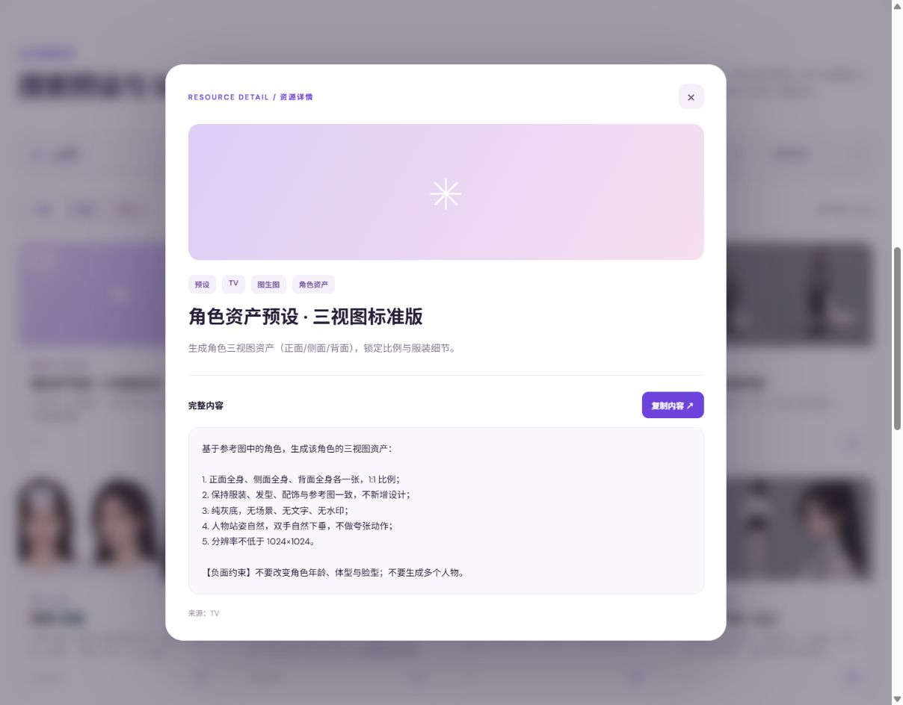

# AI 创作资源工作台｜Skill、预设与 Agent

麦香冰的个人项目展示。这个项目把创作预设、Skill 正文和检索型 Agent 放在同一套资源工作流里：**搜索资源 → 查看完整内容 → 复制或管理 → 用 Agent 基于资源回答问题**。

**[打开公开展示页](https://cbb66612.github.io/creative-agent-showcase/)** · 在线可浏览、筛选、查看详情和复制公开资源。GitHub Pages 不能运行 Python；Agent 对话、账号管理、上传和统计需要运行仓库中的完整应用。


## 界面预览

以下均为公开展示页的实际截图，使用的资源来自已过滤 Flow Skill 的公开快照。

**搜索与筛选：**按“三视图”搜索，找到相关预设和 Skill。


**详情与复制：**打开一条预设，查看完整正文和复制入口。



## 具体功能

| 功能 | 公开展示页 | 完整 Python 应用 |
| --- | --- | --- |
| 搜索与浏览预设、Skill | 名称、分类、简介和正文搜索；类型、来源、分类筛选 | 资源库搜索、分页与详情 |
| 使用内容 | 查看完整正文、复制内容 | 查看正文；对有 ZIP 版本的 Skill 下载原包 |
| 维护资源 | — | 上传 ZIP、维护预设、查看版本与文件树 |
| Agent 辅助 | 页面介绍功能，无在线对话 | 调用 `search_library`、`open_resource`、`list_taxonomy`、`library_stats`，结合资源库回答问题 |
| 管理 | — | 登录与权限、数据概览、AI 设置、后台同步入口 |

Agent 需要使用者自行配置模型 API Key。未配置时，资源浏览、搜索与管理功能仍可运行。后台同步功能还需要相应平台的授权和本机配置；本仓库不包含登录凭据。

## 公开数据与边界

- 6,176 条资源：5,963 条预设、213 个非 Flow Skill；2,549 张封面。
- Flow 平台的 75 个 Skill 和另外 2 条含 Flow Skill 内容或明确标注 Flow 的 TV Skill 已排除。关联 ZIP、解压文件、版本、文件索引及分析数据均未上传。
- 历史 ZIP 版本都属于上述 Flow Skill，因此公开快照中没有历史 ZIP 可下载；完整应用的 ZIP 上传、版本和下载代码仍在，新上传的非 Flow ZIP 可使用这些功能。
- 账号、密码哈希、会话、操作日志、Agent 对话、Cookie、模型密钥和本机配置未收录。
- 资源详情保留来源信息。界面与应用实现作为个人项目展示，第三方资源正文不宣称为作者原创。

## 本地运行完整应用

需要 Python 3.12 或兼容版本。在仓库根目录运行：

```powershell
python scripts/restore_public_data.py
python server/app.py
```

打开 <http://127.0.0.1:8000>。首次启动会在**本机** `server/data/初始账号.txt` 生成随机管理员密码，账号为 `demo_admin`。Windows 也可双击 `server/start.bat`，使用端口 8012。Agent 的模型密钥在管理员设置页配置，只保存在本机。更多启动说明见 [server/README.md](server/README.md)。

静态展示页可在仓库根目录执行 `python -m http.server 8001` 后访问 <http://127.0.0.1:8001>。它读取 `data-export/resources.json`；完整应用读取恢复后的 SQLite 数据库。

## 仓库结构

```text
index.html / style.css / app.js   GitHub Pages 展示页
data-export/                      公开资源 JSON、SQLite 快照与封面
server/                           Python 应用、资源管理、AI 助手和 Agent
scripts/restore_public_data.py    将公开快照复制到本机运行目录
```

本地原项目继续保留其原始名称与用途；本仓库是独立的个人展示版本。
